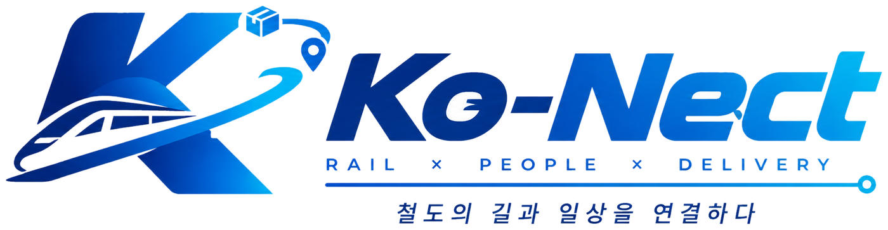
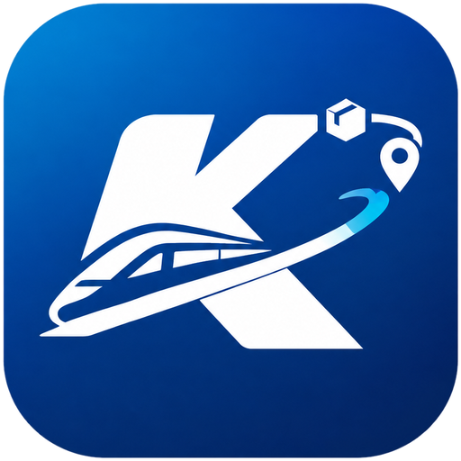
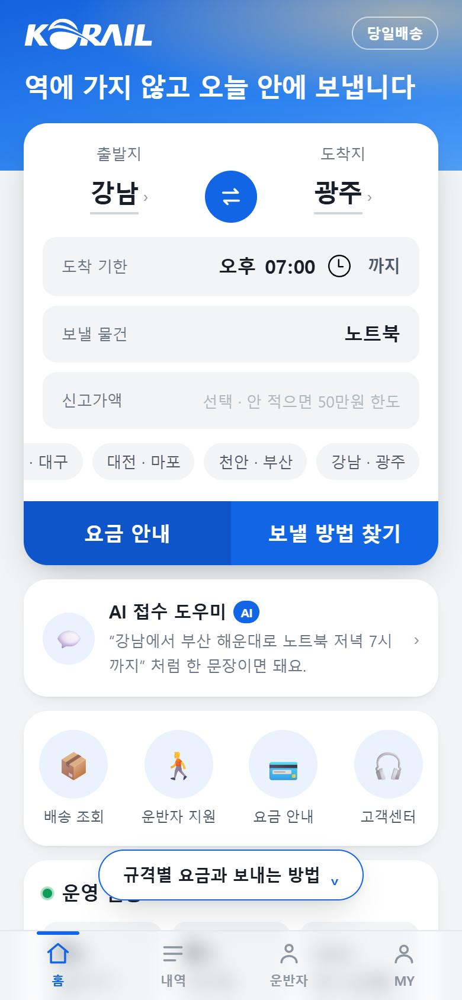
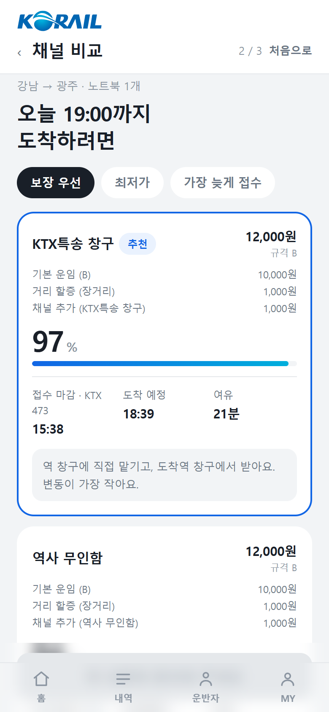
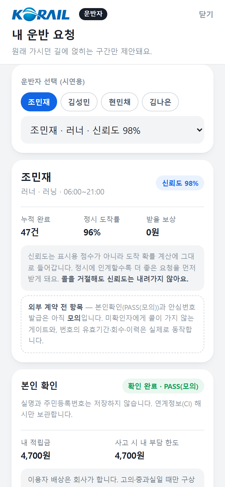
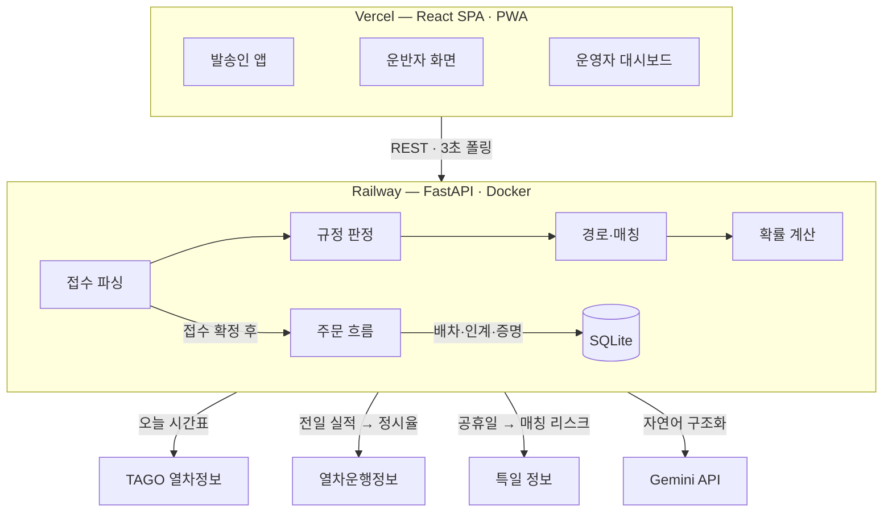
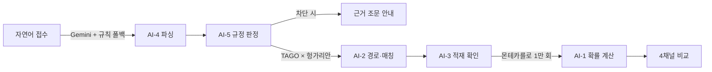
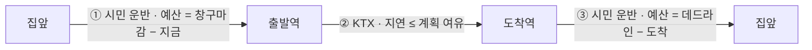
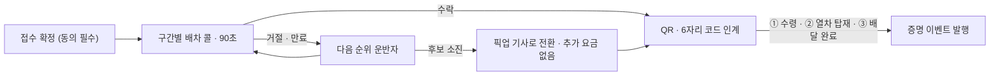

<div align="center">



<br/><br/>



# Ko-Nect · KTX 당일배송

**시민과 KTX가 이어 달리는 당일 특송 — 역에 가지 않고 오늘 안에 보냅니다**

MOVE-AI CHALLENGE 2026 · 한국철도공사 트랙 제안 프로토타입입니다.

[](https://move-ai-mu.vercel.app)
[](https://github.com/Patrick-SCH03/MOVE-AI-CHALLENGE-2026/actions/workflows/ci.yml)

</div>

---

## 프로젝트 소개

KTX특송은 이미 빠릅니다. 서울에서 부산까지 3시간이면 화물이 도착합니다.
문제는 하나뿐입니다 — **보내는 사람도 받는 사람도 역까지 가야 한다는 것.**

이 프로젝트는 그 앞뒤를 "배송하러 나가는 사람"이 아니라 **원래 그 길을 가던 시민**에게 얹습니다.

```
집앞 →(시민 운반)→ 출발역 →(KTX 특송)→ 도착역 →(시민 운반)→ 집앞
```

그리고 차별점은 속도가 아니라 **확률**입니다. "오늘 18시까지 97%" — 화면의 세 구간
확률을 곱하면 종합 확률이 소수점까지 그대로 나옵니다. 지어낸 숫자가 아니라
몬테카를로 10,000회의 **계산 결과**라는 뜻이고, 테스트가 매번 그 곱셈을 검증합니다.

---

## 화면

<table>
<tr>
<td align="center" width="33%"></td>
<td align="center" width="33%"></td>
<td align="center" width="33%"></td>
</tr>
<tr>
<td align="center"><b>접수</b><br/>출발지·도착지·도착 기한·물건만 넣으면 됩니다</td>
<td align="center"><b>채널 비교</b><br/>4가지 보내는 방법의 운임과 도착 확률</td>
<td align="center"><b>운반자</b><br/>원래 가던 길에 얹히는 구간만 콜로 받습니다</td>
</tr>
</table>

---

## 누가 어떻게 쓰나

| 사용자 | 하는 일 | 화면 |
|---|---|---|
| **발⁠송⁠인** | 출발지·도착지·도착 기한·물건을 넣거나 한 문장으로 말하면, 4채널의 운임과 도착 확률을 비교해 접수합니다 | `/` |
| **운⁠반⁠자** | 출퇴근길 시민입니다. 내 동선에 얹히는 구간만 콜로 받고, 수락하면 QR·6자리 코드로 물건을 넘깁니다 | `/?view=carrier` |
| **운⁠영⁠자** | 코레일 담당자입니다. 역별 현황·배차 실황·남은 편성과 적재율·실측/가정 대장을 봅니다 | `/?view=ops` |

---

## 아키텍처

### 시스템 구성



- **프론트엔드** — React 앱 하나가 주소의 `view` 값으로 발송인·운반자·운영자 화면을 나눕니다. 서버와는 REST로 통신하고, 배차 콜처럼 바뀌는 상태는 3초 폴링으로 받습니다.
- **백엔드** — FastAPI가 접수 파이프라인(도구 5개)과 주문 흐름을 맡고, 주문·구간·콜·증명 기록을 SQLite에 저장합니다.
- **외부 연동** — 시간표는 하드코딩하지 않고 **그날의 편성을 공공데이터에서 받습니다**. 외부 호출에는 하드 데드라인과 회로 차단을 걸고, Gemini 키가 없거나 늦으면 규칙 파서로 같은 흐름을 이어 갑니다.

### AI 접수 파이프라인

접수 문장 하나에 **도구 다섯 개**가 순서대로 붙고, 호출 로그가 화면에 그대로 남습니다.



| 단계 | 하는 일 | 코드 |
|---|---|---|
| **A⁠I⁠-⁠4 파⁠싱** | 문장에서 출발지·도착지·기한·물건·가액을 뽑습니다. Gemini 구조화 출력이 기본이고 실패하면 규칙 파서가 받습니다 | `tools/parse.py` |
| **A⁠I⁠-⁠5 규⁠정 판⁠정** | 금지품·수탁 상한·고가품을 실제 약관 조문으로 판정하고, 막으면 근거 조문을 보여 줍니다 | `tools/screen.py` |
| **A⁠I⁠-⁠2 경⁠로·매⁠칭** | 오늘 편성으로 3구간 경로를 조립하고, 구간별 운반자 후보를 헝가리안 알고리즘으로 전역 배정합니다 | `tools/route.py` · `tools/match.py` |
| **A⁠I⁠-⁠3 적⁠재 확⁠인** | 열차 적재 공간을 확인합니다. 실제 연동은 계약이 필요한 영역이라 형식만 둔 모의 단계입니다 | `agent.py` |
| **A⁠I⁠-⁠1 확⁠률** | 몬테카를로 1만 회로 구간별·종합 도착 확률을 계산합니다 | `tools/probability.py` |
| **채⁠널 비⁠교** | 창구·무인함·시민 운반·픽업마다 탈 수 있는 열차가 달라, 채널별 최적 편성으로 운임과 확률을 따로 계산합니다 | `tools/channels.py` |

### 3구간 릴레이와 도착 확률



종합 확률은 **세 구간 확률의 곱**입니다. 구간마다 쓸 수 있는 시간(예산)은 비례 배분이 아니라 창구 마감·열차 도착 같은 **운영 규칙에서 거꾸로 계산**합니다. 운반자 신뢰도와 열차 정시율은 표시용 숫자가 아니라 이 계산의 입력값이라, 운반자를 바꾸면 확률도 다시 계산됩니다.

### 주문 흐름



- 콜을 거절해도 운반자에게 **불이익이 없습니다**. 다음 순위에게 콜이 넘어갑니다.
- 후보가 모두 거절하거나 응답하지 않으면 그 구간은 **픽업 기사로 전환**되어 흐름이 끊기지 않습니다.
- 인계는 순서대로만 됩니다. 앞 구간이 끝나지 않았거나 코드가 틀리면 서버가 막습니다.

---

## 주요 기능

| 기능 | 설명 |
|---|---|
| **자⁠연⁠어 접⁠수** | "강남에서 서면으로 노트북 85만원짜리 저녁 6시까지" 한 문장 → 견적. 폼이 기본, 대화는 값이 빠졌을 때만 |
| **4⁠채⁠널 비⁠교** | 창구·무인함·시민 운반·픽업. 채널마다 도착 후 수령 시간이 달라 **탈 수 있는 열차가 다르다** — 각자 최적 편성으로 계산 |
| **확⁠률 곱 불⁠변⁠식** | 구간확률의 곱 = 종합확률 (오차 < 0.002). 상한 99% — 100%는 확률이 아니라 약속으로 읽힌다 |
| **운⁠반⁠자 교⁠체 시⁠연** | 같은 경로에서 사람만 바꾸면 확률이 재계산 — 그 구간의 실제 매칭 후보만 제시 |
| **배⁠차 콜** | 90초 타임아웃, 거절·만료 시 다음 순위. **전부 거절돼도** 구간이 픽업 기사로 전환되어 흐름이 끊기지 않는다 |
| **Q⁠R 인⁠계 · 증⁠명** | 구간마다 QR 상호 스캔 + 6자리 코드 병기. 인계마다 증명 이벤트 발행, 외부 조회 API(건당 300원 과금 모델) |
| **지⁠연 대⁠응** | 지연 주입(시연) → 확률 재계산 → 못 맞추면 **도착역 직접 수령 전환**을 대안으로 제시하고 버튼으로 실행 |
| **운⁠반⁠자 보⁠호 장⁠치** | 콜 거절 무불이익(근로자성) · 보증금은 운임에서 적립(예치금 없음) · 안심번호(모의, 인계 후 회수) |
| **운⁠영⁠자 대⁠시⁠보⁠드** | 역별 현황 · 배차 실황 · 남은 편성/적재율 · 배상 재원 · **실측/가정 대장**(가정을 숨기지 않는다) |

---

## 기술 스택

<table>
<tr>
<td align="center" width="33%">

### AI · 엔진

 

**Gemini 3.6 Flash** (구조화 출력)<br/>
**NumPy** 몬테카를로 10,000회<br/>
헝가리안 알고리즘 (직접 구현)<br/>
**TAGO 공공데이터** (당일 시간표)

</td>
<td align="center" width="33%">

### Back-end

 

**FastAPI** · **SQLModel**<br/>
**SQLite** · **Docker**<br/>
**Railway** (배포)

</td>
<td align="center" width="33%">

### Front-end


**React 19** · **Vite**<br/>
**Tailwind CSS**<br/>
**Vercel** (배포)

</td>
</tr>
</table>

| 영역 | 선택 | 이유 |
|---|---|---|
| **시⁠간⁠표** | TAGO 공공데이터 당일 수신 | 하드코딩하면 그 순간 낡는다. 포털이 날짜를 하루 밀어 주는 특성까지 응답 날짜 검증으로 흡수 |
| **자⁠연⁠어 접⁠수** | Gemini + 규칙 폴백 | 폴백이 있다는 것은 외부가 느릴 때 포기할 줄 안다는 뜻 — 키가 없어도 같은 흐름이 돈다 |
| **전⁠역 배⁠정** | 헝가리안 직접 구현 | SciPy 함수 하나 때문에 40MB를 넣지 않는다. 무작위 200회 완전탐색 대조 테스트 동반 |
| **실⁠시⁠간⁠성** | 3초 폴링 | WebSocket은 무료 티어에서 연결 유지가 불안정. 폴링으로 충분하고 배포가 단순 |
| **지⁠오⁠코⁠딩** | 내장 지명 사전 | 외부 키 없이도 동작이 같아야 하고, 시연 좌표가 흔들리면 안 된다 |
| **D⁠B** | SQLite | 단일 인스턴스 프로토타입에 별도 DB 서버는 과투자 |

---

## 프로젝트 구조

```
├── backend/
│   ├── app/
│   │   ├── clock.py          # "HH:MM" ↔ 분 — 시각 파싱은 여기서만
│   │   ├── publicdata.py     # 공공데이터 공통 (회로차단·디스크캐시·스레드 데드라인)
│   │   ├── tago.py           # 오늘 운행 KTX (날짜 밀림 보정·하루 캐시)
│   │   ├── agent.py          # 오케스트레이터 — 도구 호출 순서 + 로그
│   │   ├── orderflow.py      # 접수·배차 콜·대체 전환·인계·알림
│   │   ├── models.py         # Order · Leg · Call · ProofEvent · ProofAccess
│   │   ├── tools/
│   │   │   ├── probability.py   # AI-1 몬테카를로 (곱셈 불변식)
│   │   │   ├── match.py         # AI-2 게이트 + 헝가리안 전역 배정
│   │   │   ├── parse.py         # AI-4 Gemini 구조화 출력 + 규칙 폴백
│   │   │   ├── screen.py        # AI-5 규정·금지품 판정 (실제 조문만)
│   │   │   ├── route.py         # 3구간 경로 조립 (예산은 운영 규칙에서 역산)
│   │   │   └── channels.py      # 4채널 비교 + 배분표 (import 시점 합계 검증)
│   │   ├── seed/             # 요율(공시)·정시율(공표)·취급역 14·운반자 380·약관 전문
│   │   └── routers/          # meta · tools · orders · carrier · ops
│   └── tests/check_all.py    # 성질 검사 — 서버·키 없이 돈다
├── frontend/
│   └── src/
│       ├── screens/          # Home · ChatIntake · ChannelCompare · Progress
│       │                     # History · CarrierApp · OpsView · Legal · My
│       └── components/       # RelayRoute(곱셈 행) · CarrierSwap · PlacePicker …
├── docs/screens/            # README 화면 캡처
└── .github/workflows/ci.yml  # 키 없이 도는 검사만 — 키를 기다리는 CI는 빨간 배지만 남는다
```

---

## API

| 메서드 | 경로 | 설명 |
|---|---|---|
| `GET` | `/api/health` | 상태 + 외부 연동이 **왜 안 되는지** (TAGO 상태·오늘 편수·기준 시각) |
| `POST` | `/api/agent` | 자연어 접수 오케스트레이터 — `tool_calls` 로그 포함 |
| `POST` | `/api/route` | 3구간 경로 (`force_carriers`로 운반자 수동 지정) |
| `POST` | `/api/orders` | 접수 확정 — **동의 없으면 400** (서버가 막는다) |
| `GET` | `/api/orders/{id}/notifications` | 알림 타임라인 + `eta_now` `probability_now` `delay_applies` |
| `POST` | `/api/handover` | 6자리 코드 인계 — 순서 건너뜀·코드 불일치 400 |
| `GET` | `/api/proof/{id}` | 증명 조회 (같은 사업자 24시간 내 중복은 미과금) |
| `GET` | `/api/carrier/{id}/calls` · `/requests` | 운반자 콜(3초 폴링) · 수행 목록 |
| `GET` | `/api/live` · `/api/ops/board` | 홈·운영자 집계 — **전부 실제 주문 행에서** |
| `GET` | `/api/provenance` | 실측/가정 대장 |
| `GET` | `/api/documents` · `/api/terms` · `/api/consents` | 약관 본문·고지 문구·동의 항목 — 서버가 내려준다 |

---

## 주의

- 본 프로토타입은 **공식 서비스가 아니며**, 운임 일부와 표시 수치 일부는 가정치입니다.
- 운영 이력(지난 7일 주문·정시율)은 **시연용 가상 데이터**로, 예측 확률에서 결과를 생성한 것입니다.
- KORAIL CI·로고는 제안 목적으로만 사용했습니다.
- 본인확인(PASS)·안심번호 발급은 계약이 필요한 영역이라 형식만 구현하고 화면에 **'모의'**로 표시했습니다.
- 실시간 열차 지연은 공공데이터로 제공되지 않아, 시연에서는 지연을 수동으로 주입합니다.
